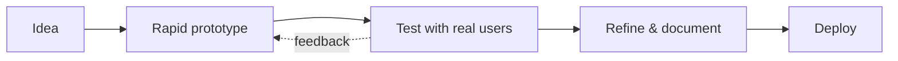

<!-- Paste into the README.md of the repo named exactly: codesbyahmad -->

<!-- ===================== HEADER ===================== -->
<div align="center">


<a href="https://github.com/codesbyahmad">
  
</a>

<br/>

<a href="https://codesbyahmad.github.io/MY_Portfolio"></a>
<a href="https://www.linkedin.com/in/ahmad-shiraz"></a>
<a href="mailto:ahmadshiraz912@icloud.com"></a>


</div>

<br/>

## 👨‍💻 About me

```yaml
name:        Ahmad Sheraz
location:    Lahore, Pakistan 🇵🇰
studying:    BS Robotics & Artificial Intelligence @ University of Lahore (2023 – 2028)
focus:       Robotics · AI Systems · Computer Vision
building:    Solar cleaning robot (ESP32) + Limo robot system (ROS 2)
certified:   Azure Fundamentals · NAVTTC AI Certification
open_to:     Robotics / AI / embedded internships & collaborations
```

> I like turning ideas into working prototypes fast: a 6-DOF arm, a RAG support agent, a gesture-tracking pipeline. Then I keep refining them until they hold up in front of real users.

<br/>

## 🛠️ Tech stack

<div align="center">

**🤖 Robotics & Embedded**


**🧠 AI & LLM Apps**


**👁️ Computer Vision**


**⚙️ Tools & Deployment**


</div>

<br/>

## 🚀 Featured projects

### 🧠 AI apps

<table>
  <tr>
    <td width="50%" valign="top">
      <h3>🩺 MedGuide AI</h3>
      <p>Medical assessment app that gives <b>source-backed guidance</b> from current medical resources. Refined over several versions and tested by real users.</p>
      <sub><code>Streamlit</code> · <code>LangChain</code> · <code>OpenAI</code></sub><br/><br/>
      <a href="https://mediguide-clinical-aii.streamlit.app/">🔗 Live demo</a> &nbsp;|&nbsp; <a href="<repo-url>">💻 Code</a>
    </td>
    <td width="50%" valign="top">
      <h3>💬 SupportPearlz AI</h3>
      <p>RAG customer-support agent answering from <b>PDF, DOCX, CSV and Markdown</b>, with <b>similarity-gated retrieval</b> to reduce hallucinations.</p>
      <sub><code>LangChain</code> · <code>ChromaDB</code> · <code>OpenAI</code></sub><br/><br/>
      <a href="https://supportpearlz-ai.streamlit.app/">🔗 Live demo</a> &nbsp;|&nbsp; <a href="<repo-url>">💻 Code</a>
    </td>
  </tr>
  <tr>
    <td width="50%" valign="top">
      <h3>💰 FinWise AI</h3>
      <p>Personal finance advisor that <b>predicts savings</b> and alerts users to future money shortfalls before they happen.</p>
      <sub><code>Streamlit</code> · <code>LangChain</code> · <code>Gemini API</code></sub><br/><br/>
      <a href="https://finwiseai-ai.streamlit.app/">🔗 Live demo</a> &nbsp;|&nbsp; <a href="<repo-url>">💻 Code</a>
    </td>
    <td width="50%" valign="top">
      <h3>🧬 Helix AI</h3>
      <p>Custom ChatGPT-style AI agent that routes a LangChain pipeline through the OpenAI API to LLMs.</p>
      <sub><code>Streamlit</code> · <code>LangChain</code> · <code>OpenAI API</code></sub><br/><br/>
      <a href="https://helix-aii.streamlit.app/">🔗 Live demo</a> &nbsp;|&nbsp; <a href="<repo-url>">💻 Code</a>
    </td>
  </tr>
  <tr>
    <td width="50%" valign="top">
      <h3>📈 MarketMind AI</h3>
      <p>Autonomous business research agent that generates <b>management-consultancy market intelligence briefs</b>. Native Python with schema-validated tool calling, evidence tracking, real-time API cost calculation and a <b>human approval gate</b> before report export.</p>
      <sub><code>Python</code> · <code>Tool calling</code> · <code>Streamlit</code></sub><br/><br/>
      <a href="https://marketmindaii.streamlit.app/">🔗 Live demo</a> &nbsp;|&nbsp; <a href="<repo-url>">💻 Code</a>
    </td>
    <td width="50%" valign="top">
      <h3>🖼️ See &amp; Describe</h3>
      <p>Multi-modal vision app that analyzes live video or uploaded media, detects objects, generates scene descriptions with <b>vision-language transformers</b>, translates them across languages and <b>reads them aloud</b>. Built for assistive robotics and HCI.</p>
      <sub><code>Computer Vision</code> · <code>Vision-Language</code> · <code>TTS</code> · <code>Streamlit</code></sub><br/><br/>
      <a href="https://see-and-describe-4fx7u5s5hldcnsxwabqdgn.streamlit.app/">🔗 Live demo</a> &nbsp;|&nbsp; <a href="<repo-url>">💻 Code</a>
    </td>
  </tr>
  <tr>
    <td width="50%" valign="top">
      <h3>👁️ Low Vision Assessment</h3>
      <p>18-task assessment tool built for an external user in <b>2 working days</b>, with participant records and <b>Excel/CSV export</b>.</p>
      <sub><code>Web app</code> · <code>Render</code></sub><br/><br/>
      <a href="https://low-vision-assessment.onrender.com/">🔗 Live demo</a> &nbsp;|&nbsp; <a href="<repo-url>">💻 Code</a>
    </td>
    <td width="50%" valign="top">
      <h3>📂 More on GitHub</h3>
      <p>Smaller experiments, data analysis and web projects, including a <a href="https://codesbyahmad.github.io/ramdan-countdown/">Ramadan countdown</a>.</p>
      <sub><code>Python</code> · <code>JavaScript</code> · <code>HTML</code></sub><br/><br/>
      <a href="https://github.com/codesbyahmad?tab=repositories">📦 All repositories</a>
    </td>
  </tr>
</table>

### 🤖 Vision & robotics

<table>
  <tr>
    <td width="50%" valign="top">
      <h3>🖐️ Gesture Controller</h3>
      <p>Real-time <b>gesture recognition and tracking</b> pipeline built on computer vision.</p>
      <sub><code>OpenCV</code> · <code>MediaPipe</code> · <code>Streamlit</code></sub><br/><br/>
      <a href="https://gesture-controller.streamlit.app/">🔗 Live demo</a> &nbsp;|&nbsp; <a href="<repo-url>">💻 Code</a>
    </td>
    <td width="50%" valign="top">
      <h3>☀️ Solar Cleaning Robot</h3>
      <p>Crawling robot that cleans solar panels with a roller microfiber brush and water nozzle. Edge sensors and motors handle repositioning, with cloud sync.</p>
      <sub><code>Arduino</code> · <code>ESP32</code> · <code>Firebase</code></sub><br/><br/>
      <a href="<repo-url>">💻 Code</a>
    </td>
  </tr>
  <tr>
    <td width="50%" valign="top">
      <h3>🚗 Limo Robot System</h3>
      <p>Recreates the fundamental working system of a Limo robot with sensors, motors and a controller, tested in <b>Gazebo simulation</b>.</p>
      <sub><code>ROS 2 Humble</code> · <code>Gazebo</code> · <code>Linux</code></sub><br/><br/>
      <a href="<repo-url>">💻 Code</a>
    </td>
    <td width="50%" valign="top">
      <h3>🦾 6-DOF Robotic Arm</h3>
      <p>Prototype-scale version of the industrial 6-DOF arm, built with a controller, servos and motors.</p>
      <sub><code>Servo control</code> · <code>Embedded</code></sub><br/><br/>
      <a href="<repo-url>">💻 Code</a>
    </td>
  </tr>
</table>

<br/>

## 🧭 How I build



<br/>

## 📊 GitHub stats

<div align="center">


</div>

<br/>

## 🎓 Education & certifications

- 🎓 **BS Robotics & Artificial Intelligence**, University of Lahore (Sept 2023 – May 2028, expected)
- ☁️ **Microsoft Certified: Azure Fundamentals**
- 🏅 **AI Certification**, NAVTTC, Govt. of Pakistan (Tech Joint Lahore), covering Machine Learning, Deep Learning and Agentic AI

<br/>

## 🤝 Let's connect

I'm open to **robotics, AI and embedded internships and collaborations**. Email is the fastest way to reach me.

<div align="center">

<a href="mailto:ahmadshiraz912@icloud.com"></a>

<br/><br/>


</div>
