<h1 align="center"> AHMAD SHERAZ </h1>

<h3 align="center">Robotics &amp; AI Engineer-in-the-making</h3>

  <b>ROS 2</b> &nbsp;•&nbsp; <b>Embedded Systems</b> &nbsp;•&nbsp; <b>LLM Apps</b> &nbsp;•&nbsp; <b>Computer Vision</b>

  <i>I build robots that sense and act, and AI apps that people actually use.</i>

  
  
  
  
  

## 🔭 What I'm up to

- 🚧 **Building now:** a solar panel cleaning robot (ESP32 + Firebase) and a Limo robot system on ROS 2
- 🎓 **Studying:** BS Robotics &amp; AI, University of Lahore (2023 – 2028)
- 🏅 **Certified:** Microsoft Azure Fundamentals · AI Certification (NAVTTC, Govt. of Pakistan)
- 📫 **Open to:** robotics, AI and embedded internships and collaborations

> I like turning ideas into working prototypes fast, then refining them until they hold up in front of real users.

## 🛠️ Tech stack

**🤖 Robotics &amp; Embedded** 

**🧠 AI &amp; LLM Apps** 

**👁️ Computer Vision** 

**⚙️ Tools &amp; Deployment** 

## 🚀 Featured projects

### 🧠 AI apps

 
<a href="https://github.com/codesbyahmad/medguide-ai">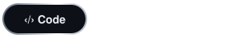</a>

 

 

 

### 🤖 Vision &amp; robotics

 

 

  <b>Let's build something together.</b> 
  <a href="mailto:ahmadshiraz912@icloud.com">ahmadshiraz912@icloud.com</a>

